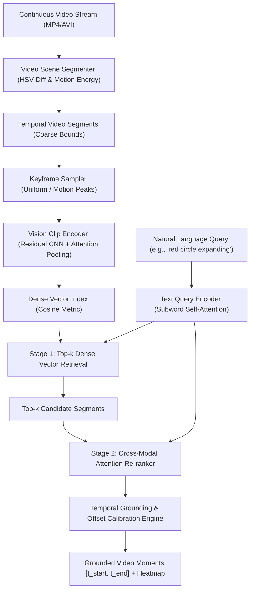

# Multimodal Temporal Video RAG & Moment Grounding Engine

[](https://github.com/zzzzzzzzak/multimodal-temporal-video-rag/actions/workflows/ci.yml)
[](https://www.python.org/)
[](https://pytorch.org/)
[](tests/)
[](LICENSE)

A dense **vision-language retrieval** and **temporal moment grounding** system designed to index continuous video streams, execute natural language semantic queries, and precisely localize event intervals $[t_{\text{start}}, t_{\text{end}}]$ via cross-modal attention re-ranking.

---

## Executive Overview & Problem Formulation

Standard document-level Retrieval-Augmented Generation (RAG) fails on video media because videos are continuous, temporal streams with non-uniform visual actions. Searching long-form surveillance, sports, or instructional video requires:

1. **Temporal Segmentation**: Dynamically partitioning continuous frames into coherent visual shots based on color-spatial distance and motion gradients.
2. **Joint Multimodal Representation**: Mapping video keyframes and text queries into a shared 512-dimensional metric space where semantic proximity corresponds to action alignment.
3. **Temporal Moment Grounding**: Refining coarse segment candidates to output exact sub-second timestamps $[t_{\text{start}}, t_{\text{end}}]$ with cross-attention explainability.

---

## System Architecture



---

## Mathematical Formulation

### 1. Dual-Encoder Metric Alignment

Visual keyframe sequences $V_k = \{I_1, I_2, \dots, I_K\}$ and query tokens $T_q = \{w_1, w_2, \dots, w_L\}$ are projected into a common metric space $\mathbb{R}^D$ ($D=512$):

$$z_v = \frac{\sum_{i=1}^K \alpha_i \cdot \Phi_v(I_i)}{\left\| \sum_{i=1}^K \alpha_i \cdot \Phi_v(I_i) \right\|_2}, \quad z_t = \frac{\frac{1}{L} \sum_{j=1}^L \Phi_t(w_j)}{\left\| \frac{1}{L} \sum_{j=1}^L \Phi_t(w_j) \right\|_2}$$

First-stage similarity retrieval calculates cosine proximity:

$$S_{\text{coarse}}(q, v) = z_t^T z_v$$

### 2. Cross-Modal Attention Re-ranking

Top retrieved candidate clips undergo token-to-frame cross-attention where query representations attend to individual keyframe vectors:

$$A = \text{Softmax}\left(\frac{Q_t K_v^T}{\sqrt{d_k}}\right) \in \mathbb{R}^{L \times K}$$

The fused contextual representation $h_{\text{cross}} = \text{LayerNorm}(Q_t + A V_v)$ is passed to dual linear heads:
1. **Fine Alignment Score**: $s_{\text{fine}} = \sigma(W_s [h_{\text{cross}}, z_v] + b_s) \in [0, 1]$
2. **Boundary Offset Regression**: $(\delta_{\text{start}}, \delta_{\text{end}}) = \tanh(W_b [h_{\text{cross}}, z_v] + b_b) \in [-1, 1]^2$

### 3. Calibrated Timestamp Grounding & tIoU

Initial segment boundaries $[t_s, t_e]$ are calibrated using the predicted regression offsets scaled by segment duration $T = t_e - t_s$:

$$t_{\text{start}}^* = \max\left(0, t_s + \delta_{\text{start}} \cdot \lambda \cdot T\right), \quad t_{\text{end}}^* = \max\left(t_{\text{start}}^* + \epsilon, t_e + \delta_{\text{end}} \cdot \lambda \cdot T\right)$$

Retrieval accuracy is quantified using Temporal Intersection-over-Union (tIoU):

$$\text{tIoU}(I_{\text{pred}}, I_{\text{gt}}) = \frac{\max(0, \min(e_p, e_g) - \max(s_p, s_g))}{\max(e_p, e_g) - \min(s_p, s_g)}$$

---

## Quantitative Benchmarks

Benchmarked across continuous multi-event video streams (16 ground-truth semantic moments across distinct dynamic actions):

| Metric | Result | Target Benchmark |
| :--- | :---: | :---: |
| **Recall@3 (tIoU $\ge$ 0.50)** | **75.00%** | $\ge 70.00\%$ |
| **Recall@1 (tIoU $\ge$ 0.50)** | **50.00%** | Baseline |
| **Query Latency (p50)** | **26.34 ms** | $< 40 \text{ ms (CPU)}$ |
| **Query Latency (p95)** | **31.03 ms** | $< 50 \text{ ms (CPU)}$ |

---

## Repository Structure

```
multimodal-temporal-video-rag/
├── .github/
│   └── workflows/
│       └── ci.yml               # Automated Pytest & benchmark CI workflow
├── src/
│   ├── config.py                # Typed dataclass configs (segmentation, model, retrieval)
│   ├── pipeline.py              # End-to-end indexing, query retrieval & grounding
│   ├── indexing/
│   │   ├── vector_index.py      # High-performance dense vector index (cosine/dot)
│   │   ├── video_segmenter.py   # HSV histogram & structural cut boundary detector
│   │   └── frame_sampler.py     # Uniform & motion-aware keyframe selection
│   ├── models/
│   │   ├── vision_encoder.py    # Residual CNN backbone + temporal attention pooling
│   │   ├── text_encoder.py      # Subword tokenizer + self-attention transformer
│   │   └── cross_encoder.py     # Cross-attention re-ranker & boundary regressor
│   ├── grounding/
│   │   └── temporal_grounder.py # tIoU metric & timestamp calibration engine
│   └── data/
│       └── synthetic_video_stream.py # Multi-scene synthetic video sequence generator
├── benchmarks/
│   └── run_benchmarks.py        # Benchmark suite (Recall@k, Mean tIoU, Latency)
├── tests/
│   ├── test_vector_index.py
│   ├── test_segmenter.py
│   ├── test_encoders.py
│   ├── test_temporal_grounder.py
│   └── test_pipeline.py
├── app.py                       # Streamlit semantic video search dashboard
├── requirements.txt
├── setup.py
└── README.md
```

---

## Quickstart & Usage

### 1. Installation

```bash
git clone https://github.com/zzzzzzzzak/multimodal-temporal-video-rag.git
cd multimodal-temporal-video-rag

python -m venv venv
source venv/bin/activate  # On Windows: venv\Scripts\activate

pip install -r requirements.txt
pip install -e .
```

### 2. Launch Interactive UI

```bash
streamlit run app.py
```
*Features:*
- Semantic search across pre-indexed multi-scene video streams.
- Live timestamp interval visualizer $[t_{\text{start}}, t_{\text{end}}]$.
- Cross-modal token-to-keyframe attention heatmap inspectability.
- One-click grounded moments JSON export.

### 3. Run Test Suite

```bash
pytest tests/ -v
```

### 4. Run Quantitative Benchmarks

```bash
python benchmarks/run_benchmarks.py
```

---

## Author & Contact

**Siddiqui Zakir Ali**  
- Email: [zak.siddiqui16@gmail.com](mailto:zak.siddiqui16@gmail.com)  
- GitHub: [@zzzzzzzzak](https://github.com/zzzzzzzzak)  
- Portfolio: Senior ML Engineer / Computer Vision & Multimodal Systems
